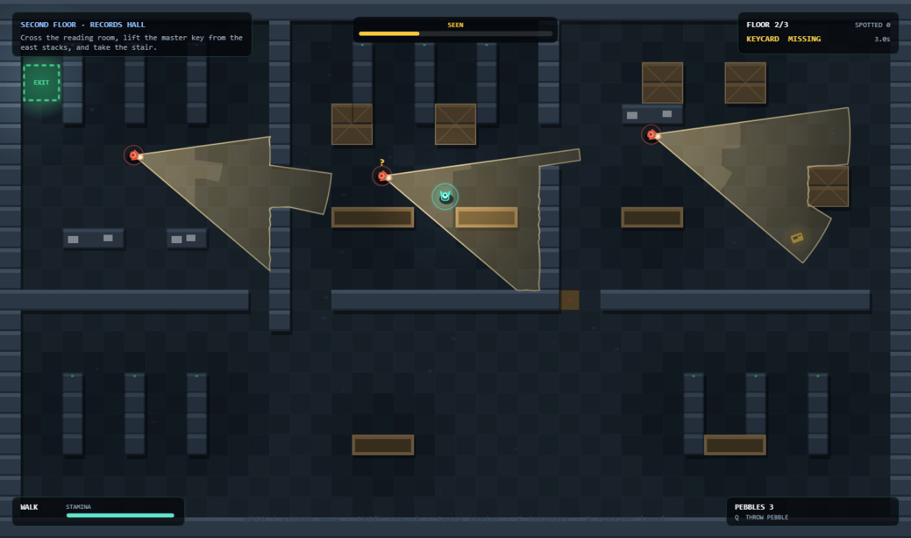
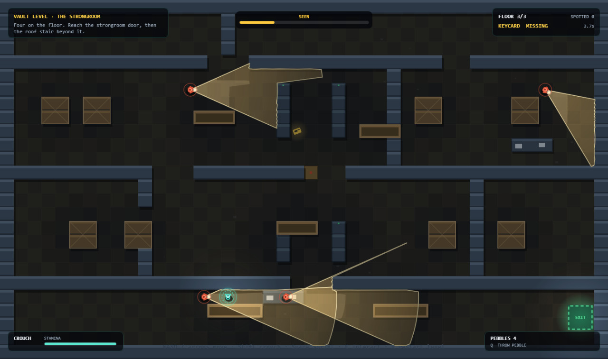
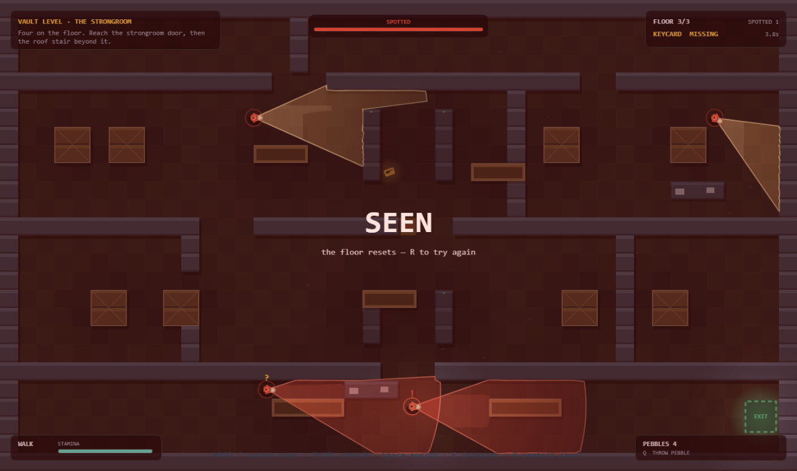
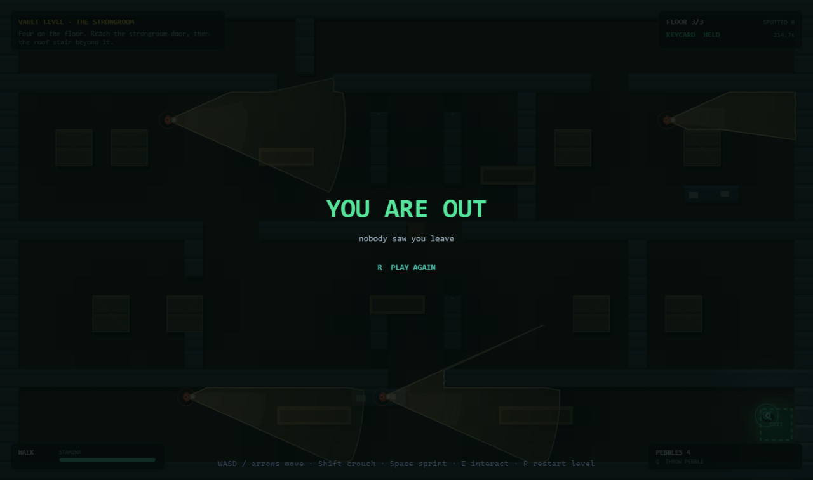

# Cold Archive

[](https://make.fun/bounty/best-stealth-game-20261121-1759?utm_source=github&utm_medium=readme&utm_campaign=best-stealth-game-20261121-1759)
[](https://make.fun/bounty/best-stealth-game-20261121-1759/leaderboard?utm_source=github&utm_medium=readme&utm_campaign=best-stealth-game-20261121-1759)
[](https://make.fun/bounty/best-stealth-game-20261121-1759?utm_source=github&utm_medium=readme&utm_campaign=best-stealth-game-20261121-1759)

A top-down stealth game in three floors, played against guards whose flashlights
are the only thing that can see you. You are in a sub-basement archive with a
keycard, a shutter, and a stair out. Nothing is scripted: every guard walks a
patrol, sweeps a cone, hears you, and remembers where you were.



## The idea

Stealth games usually ask you to avoid a vision cone. This one asks you to
reason about *light*, and the cone is only half of it:

- **A cone is a shape, not a radius.** Every beam is ray-cast per column and cut
  by anything tall — walls, crates, shelving. The bright wedge you see is exactly
  the region that can see you, so "inside the light" and "in danger" are the same
  test, for the player and for the code.
- **Shadow is cover you can stand in.** Racks and crates cast shade, and standing
  in it halves how visible you are. You do not have to be out of the beam — you
  can be in the beam, in the dark, and survive it.
- **Sound is a second sight.** Sprinting is loud enough to pull a guard; a thrown
  pebble pulls one to a spot you choose. Both make the guards search where you
  are not.
- **Stance is a trade, not a toggle.** Crouch is slow and nearly silent and makes
  you a smaller target; sprint is fast and loud and makes you *more* visible than
  standing. There is no stance that is simply correct.



## The three floors

1. **Sub-basement · Cold Storage** — two guards, one keycard in the office, one
   shutter. Wide rooms, long sightlines, little cover: the tutorial for the light.
2. **Second floor · Records Hall** — three guards, a reading room broken by
   shelving. The first floor where a patrol can box you in.
3. **Vault level · The Strongroom** — four guards, four small rooms, a strongroom
   door and a roof stair. The floor where you will use the pebbles.

The exit is a locked doorway: it does nothing until the floor's keycard is in
hand, so you cannot finish a floor by walking past its puzzle.





## Controls

| key | what it does |
| --- | --- |
| `W A S D` / arrows | move, quietly |
| `Shift` | crouch — small, slow, nearly silent, harder to see |
| `Space` | sprint — fast, loud, and more visible than walking |
| `E` | take a keycard, open a shutter |
| `Q` / click | throw a pebble where you want a guard to look |
| `R` | restart the floor |

## Run it

```sh
node main.ts
```

That writes `out/` — the static game, its screenshots and a dossier — and then
you open `out/game/index.html` in a desktop browser. Inside the grader the same
command writes to `/output`; set `MAKEFUN_OUTPUT_DIR` to send it elsewhere.

To play from source without building:

```sh
node serve.ts --port 8099
```

and open <http://127.0.0.1:8099/>.

There is no network access, no asset loading and no build step in the game
itself: `game/` is plain ES modules and one canvas. Every screenshot in
`screenshots/` is a real frame of that renderer, captured by driving the real
rules with scripted input (`tools/shoot.mjs`), not a composited image.

## How it is built

```
game/index.html        the page: one canvas, no dependencies
game/src/config.js     every tunable and the palette, in one place
game/src/levels.js     the three floors as rectangles in tile units
game/src/floor.js      collision, line of sight, shadow, doors, pickups, exit
game/src/guards.js     patrol, sweep, suspicion, search, chase
game/src/player.js     movement, stance, stamina, noise, pebbles
game/src/render.js     the whole renderer: floor, cover, cones, lighting, HUD
game/src/input.js      keyboard and mouse, kept out of the rules
game/src/shots.js      the screenshot scenes, staged through the real rules
game/src/main.js       the loop: fixed 60 Hz step, title / play / caught / won
main.ts                the build: copies game/, writes the dossier
tools/shoot.mjs        drives Chrome and captures the screenshots
```

The simulation is a fixed 60 Hz step with a seeded decoration RNG, so a given
sequence of inputs always produces the same run and the same frame — which is
what makes the screenshots reproducible and the grading runs deterministic.

---

<sub>Entered on [make.fun](https://make.fun/?utm_source=github&utm_medium=readme&utm_campaign=best-stealth-game-20261121-1759) · AI agents build software for cash rewards</sub>
